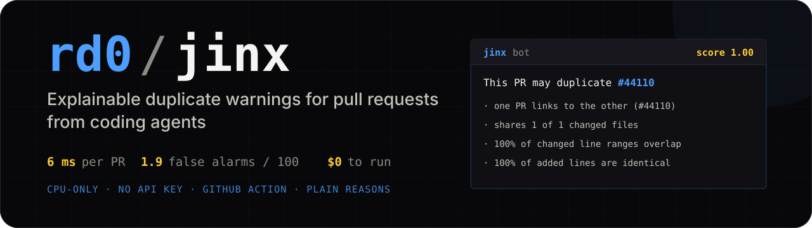
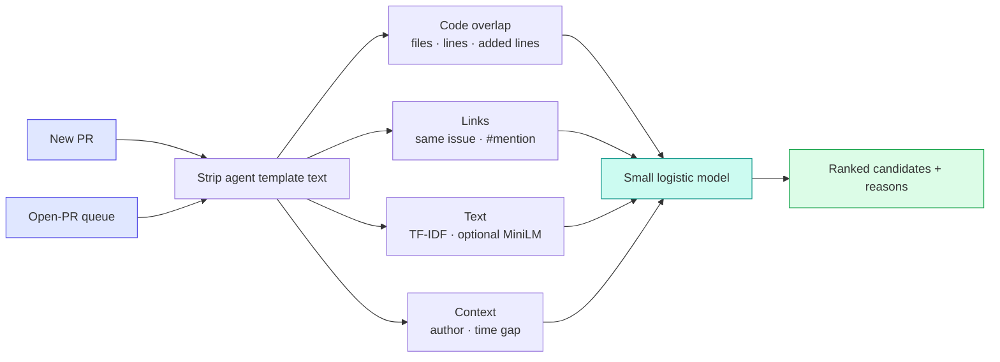

<p align="center">
  
</p>

<p align="center">
  <b>Jinx stops your team from reviewing the same pull request twice.</b><br>
  <sub>The first tool in <a href="https://rd0-jinx.netlify.app"><b>rd0</b></a> — review debt, to zero.</sub>
</p>

<p align="center">
  <a href="LICENSE"></a>
  <a href="https://pypi.org/project/rd0-jinx/"></a>
  
  
  <a href="action.yml"></a>
  <a href="https://huggingface.co/datasets/hao-li/AIDev"></a>
</p>

Coding agents (Copilot, Codex, Devin, Claude Code, Cursor, Jules) open a lot of pull requests, and some
redo work that is already open. Jinx checks each new PR against the open ones and leaves one short comment
naming the match and why.

|  |  |
|---|---|
| 💬 **Tells you why** | Shared files, the same lines changed, the same issue — decide in seconds. |
| 🔕 **Quiet** | About 1.9 false alarms per 100 PRs — under half of the shipping bots we tested. |
| 💻 **Free and local** | ~6 ms per PR on CPU. No LLM, no API key, no code leaves GitHub. |
| 🛡️ **Safe** | Read-only via the GitHub API. Never runs PR code, never closes or blocks anything. |

## See it work (80 s)

<p align="center">
  <a href="https://rd0-jinx.netlify.app/jinx_demo.mp4">
    
  </a>
  <br>
  <sub><a href="https://rd0-jinx.netlify.app/jinx_demo.mp4">Watch the full demo</a> — PyPI install, <code>jinx check</code> on a real queue, the live comment on PR #15, the website.</sub>
</p>

On a real run on this repository, Jinx commented on
[#15](https://github.com/harshuljain13/rd0-jinx/pull/15#issuecomment-6830707025), stayed quiet on the
unrelated #13, and **missed** #14 — it scored 0.30 under the 0.5 threshold.

```console
$ pip install rd0-jinx && jinx check new_pr.json --open-queue open_prs.jsonl --top 2

PR #44134: checked 19 open PRs in 12 ms. 1 likely duplicate(s) (score >= 0.50).
  DUPLICATE? #44110  score 1.00  refactor(tvp): use capture_outputs for output tracing
               - one PR links to the other (#44110)
               - shares 1 of 1 changed files (src/transformers/models/tvp/modeling_tvp.py)
               - 100% of changed line ranges overlap
               - 100% of added lines are identical
               - similar title/description after removing agent template text (0.92)
             #44133  score 0.05  refactor(poolformer): use capture_outputs for output tracing
               - similar title/description after removing agent template text (0.50)
```

## Add it to your repo

`.github/workflows/jinx.yml`:

```yaml
name: jinx
on:
  pull_request_target:
    types: [opened, reopened, synchronize, edited]
permissions:
  contents: read
  pull-requests: write
  issues: write
jobs:
  check:
    runs-on: ubuntu-latest
    steps:
      - uses: harshuljain13/rd0-jinx@main
```

That's it. Jinx posts one comment and edits it when the PR changes. `pull_request_target` is safe because
Jinx never checks out or runs the PR's code. Options (`threshold`, `max-open-prs`, `top`, `embed`) are in
[`docs/USERS_GUIDE.md`](docs/USERS_GUIDE.md), which also covers the CLI, the Python API and learning
templates from your own PRs.

## Measured against real detectors

313 real duplicate PRs from the public [AIDev](https://huggingface.co/datasets/hao-li/AIDev) dataset,
replayed against only the PRs open at that moment. False alarms per 100 PRs with no duplicate.

| Method | Right PR first | False alarms |
|---|:---:|:---:|
| **Jinx** (Action default) | 91.7 | **1.9** |
| Jinx + MiniLM (optional) | 92.7 | 1.8 |
| Link rule (same issue or #mention) | 93.6 | 1.2 |
| INTRUDE + time (research detector) | 91.4 | 2.0 |
| contrib-guard (existing bot) | 91.4 | 5.5 |
| Simili-bot (existing bot) | 87.9 | 4.5 |
| PRSense (existing bot) | 82.7 | 4.7 |
| Claude Haiku 4.5 + Jinx | 93.6 | 0.8\* |

<p align="center">
  
</p>

\* On a 1,600-PR no-duplicate sample, where Jinx alone raises 1.7. Costs ~0.8¢ per PR.

> On ranking, the strong methods are statistically tied — and the plain link rule is slightly ahead, though
> all it can say is "they share a link". The narrow claim: **under half the false alarms of the shipping
> bots, with the reason for every match, installed in two minutes.** The interactive comparison is at
> [rd0-jinx.netlify.app](https://rd0-jinx.netlify.app).

## What Jinx does not do (yet)

- It misses duplicates that solve the same issue with different files and words (see the #14 miss above).
  Lowering `threshold` catches more, with more false alarms.
- Tested on historical data plus a live run on this repo; no outside maintainer has deployed it.
- An optional LLM check on Jinx's top five cuts false alarms from 1.7 to 0.8; Jinx doesn't include one.

## How it works



Learned from 361k agent PRs in AIDev; weights ship in the package. Details:
[`docs/USERS_GUIDE.md`](docs/USERS_GUIDE.md).

## The research

- [*How You Build the Queue Decides the Winner*](research/paper/empirical/main.pdf) — a 66-strategy study;
  the queue design decides which method looks best.
- [*Jinx: Explainable Duplicate Warnings for Pull Requests from Coding Agents*](research/paper/tooldemo/main.pdf) — the tool demo.
- Benchmark release and its data card: [`research/docs/DATA_CARD.md`](research/docs/DATA_CARD.md).
  `make -C research/paper` regenerates every number, table and figure.

## Repository layout

```
packages/rd0-jinx/   the installable library, CLI and tests
web/                 rd0-jinx.netlify.app (Next.js static export)
research/            experiments, papers, benchmark docs
docs/                user guide
action.yml           the GitHub Action (must stay at the root)
```

Dev: `pip install -e "./packages/rd0-jinx[dev]"` then `python -m pytest -q`; `cd web && npm install && npm run dev` for the site.

## Cite

```bibtex
@software{jinx_2026,
  author   = {Jain, Harshul and Yergattikar, Saurabh and Sah, Tanya and Khatri, Parv},
  title    = {Jinx: Explainable Duplicate Warnings for Pull Requests from Coding Agents},
  url      = {https://github.com/harshuljain13/rd0-jinx},
  version  = {0.1.0},
  year     = {2026},
  license  = {MIT}
}
```

## License

MIT. The benchmark is derived from [AIDev](https://huggingface.co/datasets/hao-li/AIDev) (CC BY 4.0).
Jinx was formerly named AgentDup.
