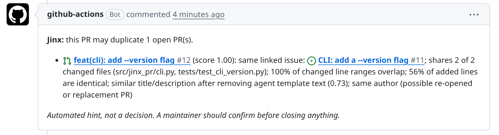
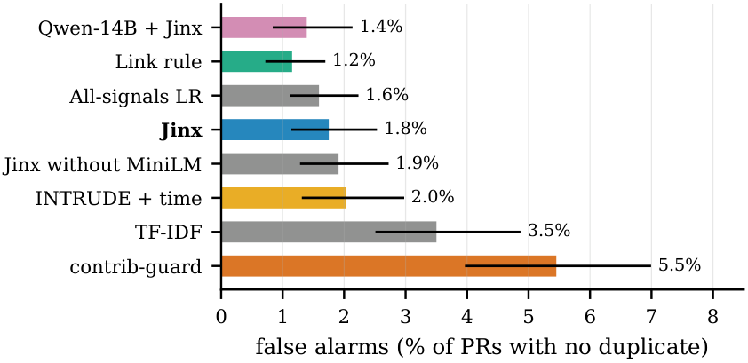
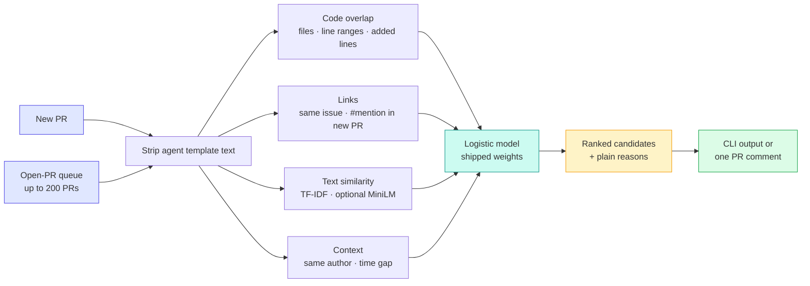
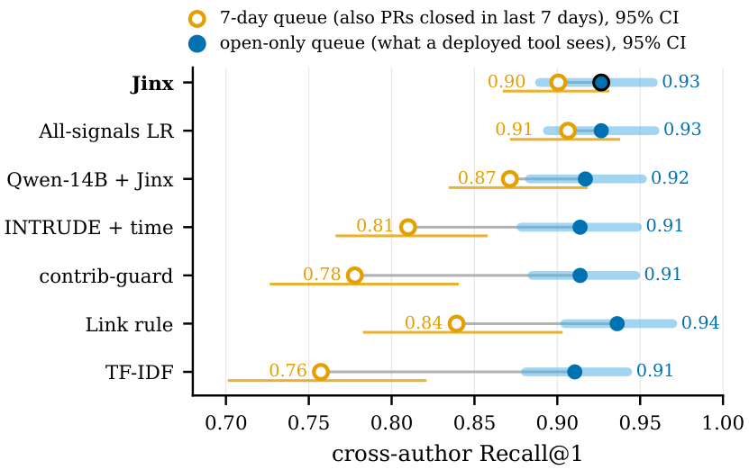

<p align="center">
  
</p>

<p align="center">
  <b>Jinx stops your team from reviewing the same pull request twice.</b><br>
  <sub>The first tool in <a href="https://rd0.ai"><b>rd0</b></a> — review debt, to zero.</sub>
</p>

<p align="center">
  <a href="LICENSE"></a>
  
  
  
  
  <a href="action.yml"></a>
  <a href="https://huggingface.co/datasets/hao-li/AIDev"></a>
  
</p>

<p align="center">
  <a href="#what-it-looks-like">What it looks like</a> ·
  <a href="#where-jinx-sits-in-the-market">Market</a> ·
  <a href="#measured-against-real-detectors">Benchmark</a> ·
  <a href="#add-it-to-your-repo">Install</a> ·
  <a href="#how-it-works">How it works</a> ·
  <a href="#the-research">Research</a>
</p>

---

Coding agents (Copilot, Codex, Devin, Claude Code, Cursor, Jules) open a lot of pull requests, and some of them
redo work that is already open. Jinx checks each new PR against the open ones. When it finds a likely duplicate,
it leaves one short comment naming the PR it matches and why.

> **rd0** is a toolkit for *review debt* — the reviewer time a team owes but has not yet paid. **Jinx** is its
> first tool, and it covers one slice: work that is already sitting in the queue. Everything below is Jinx.

|  |  |
|---|---|
| 💬 **Tells you why** | Shared files, the same lines changed, the same issue. You can decide in seconds. |
| 🔕 **Quiet** | About 1.9 false alarms per 100 PRs — under half of the shipping bots we tested. |
| 💻 **Free and local** | ~6 ms per PR on the CI machine's CPU. No LLM, no API key, no code leaves GitHub. |
| 🛡️ **Safe** | Reads PR data through the GitHub API. Never runs the PR's code, never closes or blocks anything. |

```bash
pip install "git+https://github.com/harshuljain13/rd0-jinx#subdirectory=packages/rd0-jinx"
```

The PyPI release (`pip install rd0-jinx`) is not out yet; until then, install from GitHub as above.

**Website:** [rd0.ai](https://rd0.ai) — the same story with an interactive comparison, built from [`web/`](web/). **Papers:** [empirical study](research/paper/empirical/main.pdf) · [tool demo](research/paper/tooldemo/main.pdf)

## What it looks like

A real Action run on this repository. Four PRs were opened against issue #11; Jinx commented on #15, stayed
quiet on the unrelated #13, and **missed** #14 (scored 0.30, under the 0.5 threshold).

<p align="center"></p>

```console
$ jinx check new_pr.json --open-queue open_prs.jsonl --top 2

PR #44134: checked 19 open PRs in 12 ms. 1 likely duplicate(s) (score >= 0.50).
  DUPLICATE? #44110  score 1.00  refactor(tvp): use capture_outputs for output tracing
               - one PR links to the other (#44110)
               - shares 1 of 1 changed files (src/transformers/models/tvp/modeling_tvp.py)
               - 100% of changed line ranges overlap
               - 100% of added lines are identical
               - similar title/description after removing agent template text (0.92)
             #44133  score 0.05  refactor(poolformer): use capture_outputs for output tracing
               - similar title/description after removing agent template text (0.50)
               - same author (possible re-opened or replacement PR)
```

## Where Jinx sits in the market

We read the full public documentation of every major AI review tool in November 2026, looking for duplicate,
similar or related **pull request** detection. The AI reviewers answer a different question — *is this code any
good?* — and none of them answers *is this PR already open somewhere else?* Where duplicate detection exists at
all, it is for **issues**.

| Tool | Kind | Warns a PR duplicates an **open PR** | Explains why | Reads the diff | No API key | Stays in your CI | Price |
|---|---|:---:|:---:|:---:|:---:|:---:|---|
| **Jinx** | duplicate-PR detector | ✅ | ✅ | ✅ | ✅ | ✅ | Free, MIT |
| CodeRabbit | AI reviewer + triage | 🟡 | ✅ | ✅ | ❌ | ❌ | $24–72/dev/mo · free on public repos |
| Greptile | AI reviewer | ❌ | ✅ | ✅ | ❌ | 🟡 | ~$30/seat/mo or $1/review credit |
| Graphite Diamond | AI reviewer | ❌ | ✅ | ✅ | ❌ | ❌ | $20–40/user/mo |
| GitHub Copilot review | AI reviewer | ❌ | ✅ | ✅ | ❌ | ❌ | Paid Copilot plan |
| Qodo Merge / PR-Agent | AI reviewer | ❌ | ✅ | ✅ | ❌ | 🟡 | Free tier + paid |
| contrib-guard | duplicate-PR bot | ✅ | ❌ | ❌ | ✅ | ✅ | Free, open source |
| Simili-bot | duplicate-PR bot | ✅ | 🟡 | ❌ | ❌ | ❌ | Needs a paid embedding key |
| GitHub, out of the box | platform | ❌ | ❌ | ❌ | ✅ | ✅ | Free |

<details>
<summary><b>What the 🟡 and ❌ actually mean</b></summary>

- **CodeRabbit** — Duplicate detection is a documented feature for *issues* ("Issue Enrichment"). For PRs, Triage
  surfaces *close candidates* for superseded PRs, and "Related PRs" lists merged and open PRs that touched the
  same code as reviewer context. Neither is a duplicate alarm raised on a newly opened PR.
- **Qodo Merge / PR-Agent** — ships `/similar_issue`, using embeddings and a vector database. Nothing equivalent
  exists for pull requests.
- **Greptile, Graphite, Copilot, Ellipsis, Sourcery, Dosu** — we searched each vendor's full docs for
  duplicate / similar PR / related PR and found no such feature. That is not proof no hidden feature exists.
- **Self-hosting** — Greptile offers bring-your-own-LLM self-hosting on Enterprise only; Qodo has a self-hosted
  tier. Neither keeps the default path inside your CI the way Jinx does.

Full audit, with the doc URL behind every cell: [`research/docs/commercial_tools_comparison.md`](research/docs/commercial_tools_comparison.md).
</details>

> [!IMPORTANT]
> This table is about **what each tool is built to do**, read from its own documentation. We have **not**
> benchmarked the commercial tools head to head — that needs paid accounts on live repositories. Nothing here
> says Jinx reviews code better than CodeRabbit or Greptile. It does not. It answers a question they do not ask.

## Measured against real detectors

Against the tools that *do* detect duplicate PRs, we have numbers. We replayed **313 real duplicate PRs** from
the public [AIDev](https://huggingface.co/datasets/hao-li/AIDev) dataset; every method saw only the PRs that were
genuinely open at that moment, as a bot would. Intervals are 95% bootstrap CIs clustered by repository.

| Method | Right PR ranked first (of 100) | False alarms (per 100 clean PRs) | Notes |
|---|:---:|:---:|---|
| **Jinx** (Action default) | 91.7 | **1.9** | Explains each match. Free, CPU only |
| Jinx + MiniLM (optional) | 92.7 | 1.8 | Adds a local text model; installs PyTorch |
| Link rule (same issue or #mention) | 93.6 | 1.2 | Only says "they share a link"; falls back to text similarity |
| INTRUDE + time (research detector) | 91.4 | 2.0 | Published method, no ready-to-install tool |
| contrib-guard (existing bot) | 91.4 | 5.5 | Best existing bot we tested |
| Simili-bot (existing bot, re-implemented) | 87.9 | 4.5 | |
| PRSense (existing bot, re-implemented) | 82.7 | 4.7 | |
| Claude Haiku 4.5 + Jinx | 93.6 | 0.8\* | Needs an API key, about 0.8¢ per PR |

\* On a random sample of 1,600 PRs with no duplicate, where Jinx itself raises 1.7.

<p align="center">
  
</p>

> [!NOTE]
> **The honest version.** On ranking, the strong methods are statistically tied, and a plain link rule is
> slightly ahead overall — though all it can ever tell you is "these two share a link". Our claim is the narrow
> one: Jinx raises under half the false alarms of the shipping bots, says exactly why it matched, and installs in
> two minutes.

## Add it to your repo

Create `.github/workflows/jinx.yml`:

```yaml
name: jinx
on:
  pull_request_target:
    types: [opened, reopened, synchronize, edited]
permissions:
  contents: read
  pull-requests: write
  issues: write
jobs:
  check:
    runs-on: ubuntu-latest
    steps:
      - uses: harshuljain13/rd0-jinx@main
        with:
          threshold: ""        # empty = bundled default (0.5); lower catches more, with more false alarms
          max-open-prs: "200"
          top: "3"
          embed: "false"       # "true" adds MiniLM (installs PyTorch on every run)
```

That's it. Jinx posts one comment when it finds a likely duplicate, and edits that same comment when the PR
changes. `pull_request_target` is safe here because Jinx never checks out or runs the PR's code.

### Or from the command line

```bash
pip install "git+https://github.com/harshuljain13/rd0-jinx#subdirectory=packages/rd0-jinx"   # adds the `jinx` command
pip install "rd0-jinx[embed] @ git+https://github.com/harshuljain13/rd0-jinx#subdirectory=packages/rd0-jinx"   # optional local MiniLM model

jinx check packages/rd0-jinx/examples/new_pr.json \
  --open-queue packages/rd0-jinx/examples/open_prs.jsonl --top 2
```

Input uses the GitHub API's JSON shape (`number`, `title`, `body`, `user.login`, `created_at`). The optional
fields are `diff` (unified diff text), `files`, `agent` and `linked_issues`. The queue can be a JSON list or a
JSON-lines file.

| Flag | What it does |
|---|---|
| `--top N` | List at most N candidates |
| `--threshold X` | Flag only scores ≥ X (default 0.5) |
| `--json` | Machine-readable output |
| `--embed` | Also use the local MiniLM text model (needs `[embed]`) |
| `--templates FILE` | Use templates learned from your own PRs |

### From Python

```python
from rd0_jinx import PR, Detector

new = PR.from_dict(new_pr_json)                  # GitHub API JSON shape
queue = [PR.from_dict(d) for d in open_prs_json]

det = Detector()                                 # ships with trained weights
for m in det.rank(new, queue, top=3):
    if m.score >= det.threshold:
        print(m.number, round(m.score, 2), m.reasons)
```

## How it works



1. **Remove template text.** The template lines were learned from 361k agent PRs in AIDev; lines repeated across the current queue are removed too.
2. **Compare the code:** shared files, overlapping changed line ranges, identical added lines.
3. **Check links:** the same linked issue, or the new PR mentioning the other one.
4. **Add context:** the same author, and the time gap between the PRs.
5. **Combine** these with a small logistic model. The shipped weights are in `packages/rd0-jinx/src/rd0_jinx/data/weights.json` (lexical) and `weights_emb.json` (`--embed`), trained on all 4,832 AIDev queue queries by `research/experiments/bench_v2/train_package_weights.py`.

### Learn templates for your own PRs

```bash
jinx learn-templates corpus.jsonl -o my_templates.json   # JSON-lines with agent, repo, body
jinx check new.json --open-queue open.jsonl --templates my_templates.json
```

## What Jinx does not do (yet)

- It misses duplicates that solve the same issue with different files and different words. Lowering the threshold catches more of them, at the cost of more false alarms.
- It is tested on historical data plus a live run on our own repository. No outside maintainer has deployed it yet.
- An LLM check (Claude Haiku) on Jinx's top five cuts false alarms from 1.7 to 0.8 per 100 PRs, for about 0.8¢ per PR. Jinx does not include it.

## The research

How you build the evaluation queue changes which method looks best. If the queue also keeps PRs closed in the
last 7 days, Jinx leads the research detector by 9 points; on real open-only queues the methods tie. The full
study of 66 strategies is in [`research/experiments/`](research/experiments/) and
[`research/experiments/report/REPORT.md`](research/experiments/report/REPORT.md).

<p align="center">
  
</p>

- *How You Build the Queue Decides the Winner: Re-Evaluating Duplicate Pull Request Detection on Coding-Agent PRs* — the empirical study ([PDF](research/paper/empirical/main.pdf)).
- *Jinx: Explainable Duplicate Warnings for Pull Requests from Coding Agents* — the tool demo ([PDF](research/paper/tooldemo/main.pdf)).

`make -C research/paper` regenerates every number, table and figure from the result files.
[`research/docs/DATA_CARD.md`](research/docs/DATA_CARD.md) describes the benchmark and
[`CHECKLIST.md`](CHECKLIST.md) tracks open items.

## Repository layout

```
packages/rd0-jinx/   Jinx: the installable library, CLI and tests
web/                 the rd0.ai website (Next.js static export)
research/            experiments, papers and design docs
action.yml           the GitHub Action (must live at the root)
```

The repo is `rd0` because it is the home of the toolkit; `packages/` is where each
tool lives. A second tool would arrive as `packages/rd0-<name>/` beside this one.

## Development

```bash
pip install -e "./packages/rd0-jinx[dev]"
cd packages/rd0-jinx && python -m pytest -q
ruff check .                     # repo-wide, settings in ruff.toml

cd web && npm install && npm run dev        # the website
python3 web/scripts/make_data.py            # refresh its numbers from results/
```

## License

MIT. The benchmark is derived from [AIDev](https://huggingface.co/datasets/hao-li/AIDev) (CC BY 4.0).
Authors: Harshul Jain, Saurabh Yergattikar, Tanya Sah and Parv Khatri. Jinx was formerly named AgentDup.
